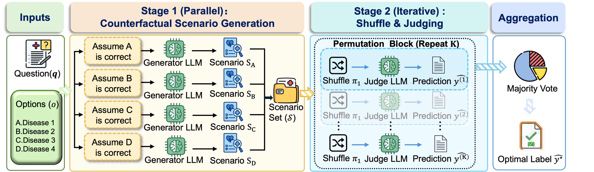
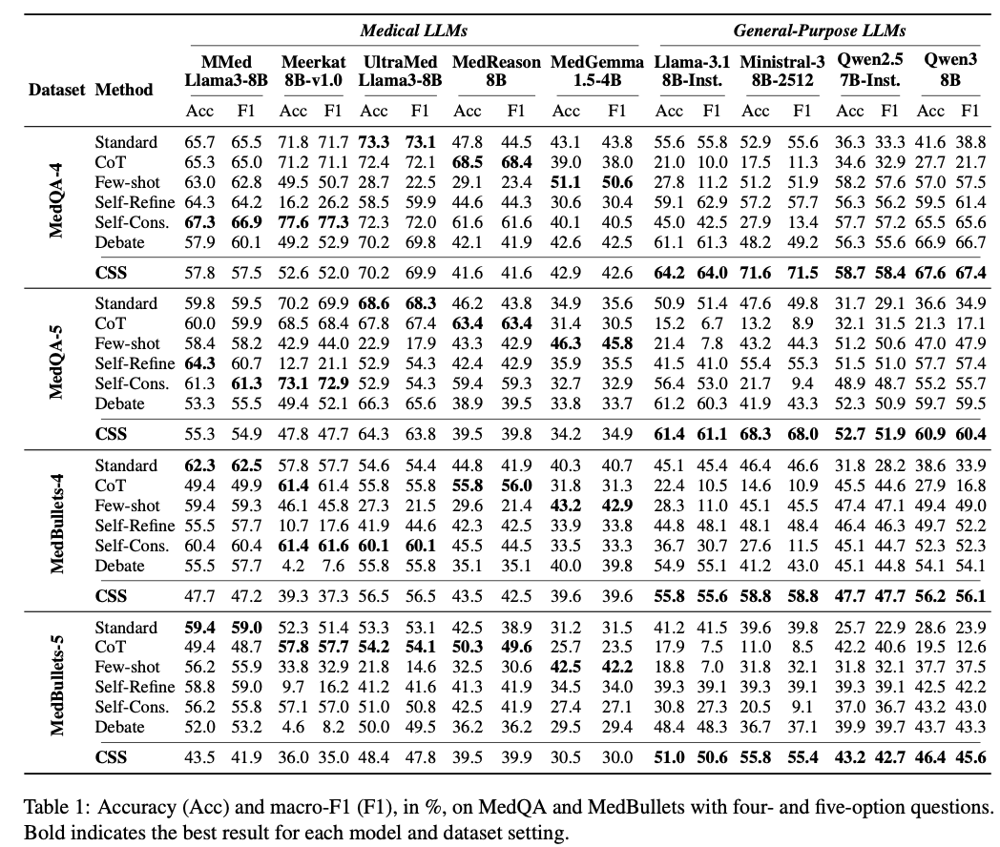

# Do Prompting Strategies Transfer to MCQA in Medical LLMs? A Comparative Analysis & Order-Invariant Clinical Scenario Simulation 
# Accepted by EACL 2027 Findings 

CSS generates an option-conditioned counterfactual scenario for each candidate answer, evaluates the scenarios under different presentation orders, and aggregates the judge's predictions. This repository provides an inference framework for **nine language models** on **MedQA** and **MedBullets**, with both four-option and five-option questions.

Supported methods are standard prompting (SP), chain-of-thought (CoT), self-consistency (SC), self-refine, multi-agent debate, and CSS. For each method, models share the same prompt content; model-specific adapters handle chat templates and loading.

## Pipeline



1. **Generate scenarios.** For each answer option, ask the generator to assume that option is correct and produce a short supporting rationale.
2. **Shuffle and judge.** Present the original question, options, and scenarios to the judge. Repeat judging over `K` scenario-order permutations, keeping the original option labels and question unchanged.
3. **Aggregate predictions.** Select the final answer by majority vote. Ties are resolved in canonical option order.

The generator and judge use the same checkpoint by default. Scenarios can be generated independently, as illustrated in the pipeline; the supplied CSS script executes generation calls sequentially. Scenario-order permutation is enabled with `--judge_permute_scenarios`, and `--judge_permute_k` sets the number of judge calls.

## Main Results



**Table 1.** Accuracy (Acc) and macro-F1 (F1), in percent, on MedQA and MedBullets with four and five answer options. Bold entries indicate the best result for each model and dataset setting. [Open the full-size table](assets/Main_reuslts.png).


## Repository Structure

```text
.
├── README.md
├── requirements.txt
├── run.py                    # Unified model/method entry point
├── evaluate.py               # Accuracy and macro F1
├── assets/
│   ├── css.png               # Pipeline figure
│   └── Main_reuslts.png      # Main results table
├── cssbench/
│   ├── models.py             # Model registry
│   ├── backend.py            # Model loading and chat templates
│   ├── prompts/              # Shared prompt content for each method
│   └── methods/              # Inference loops, answer parsing, and voting
├── data/                     # Four evaluation datasets
└── examples/
    └── run_methods.sh        # Run all six methods for one model and dataset
```

## Supported Models

Use the profile name in the first column with `--model`, and provide the checkpoint location separately.

| Group | Profile | Hugging Face model |
|---|---|---|
| Medical | `mmed` | [Henrychur/MMed-Llama-3-8B-EnIns](https://huggingface.co/Henrychur/MMed-Llama-3-8B-EnIns) |
| Medical | `meerkat` | [dmis-lab/llama-3-meerkat-8b-v1.0](https://huggingface.co/dmis-lab/llama-3-meerkat-8b-v1.0) |
| Medical | `ultramedical` | [TsinghuaC3I/Llama-3-8B-UltraMedical](https://huggingface.co/TsinghuaC3I/Llama-3-8B-UltraMedical) |
| Medical | `medreason` | [UCSC-VLAA/MedReason-8B](https://huggingface.co/UCSC-VLAA/MedReason-8B) |
| Medical | `medgemma` | [google/medgemma-1.5-4b-it](https://huggingface.co/google/medgemma-1.5-4b-it) |
| General | `llama31` | [meta-llama/Llama-3.1-8B-Instruct](https://huggingface.co/meta-llama/Llama-3.1-8B-Instruct) |
| General | `ministral` | [mistralai/Ministral-3-8B-Instruct-2512](https://huggingface.co/mistralai/Ministral-3-8B-Instruct-2512) |
| General | `qwen25` | [Qwen/Qwen2.5-7B-Instruct](https://huggingface.co/Qwen/Qwen2.5-7B-Instruct) |
| General | `qwen3` | [Qwen/Qwen3-8B](https://huggingface.co/Qwen/Qwen3-8B) |


## Installation and Data

Use Python 3.10 or later and install PyTorch for your compute environment, then install the remaining dependencies:

```bash
pip install -r requirements.txt
python run.py --help
```

| Dataset | Options | Questions | File | `--data_type` |
|---|---:|---:|---|---|
| MedQA-4 | 4 | 1,273 | `data/medqa4.jsonl` | `medqa_jsonl` |
| MedQA-5 | 5 | 1,273 | `data/medqa5.jsonl` | `medqa_jsonl` |
| MedBullets-4 | 4 | 308 | `data/medbullets_op4.csv` | `medbullets_csv` |
| MedBullets-5 | 5 | 308 | `data/medbullets_op5.csv` | `medbullets_csv` |

### Dataset Citations

**MedQA — Jin et al. (2021)**

```bibtex
@article{jin2021disease,
  title={What disease does this patient have? a large-scale open domain question answering dataset from medical exams},
  author={Jin, Di and Pan, Eileen and Oufattole, Nassim and Weng, Wei-Hung and Fang, Hanyi and Szolovits, Peter},
  journal={Applied Sciences},
  volume={11},
  number={14},
  pages={6421},
  year={2021},
  publisher={MDPI}
}
```

**MedBullets — Chen et al. (2025)**

```bibtex
@inproceedings{chen2025benchmarking,
  title={Benchmarking large language models on answering and explaining challenging medical questions},
  author={Chen, Hanjie and Fang, Zhouxiang and Singla, Yash and Dredze, Mark},
  booktitle={Proceedings of the 2025 Conference of the Nations of the Americas Chapter of the Association for Computational Linguistics: Human Language Technologies (Volume 1: Long Papers)},
  pages={3563--3599},
  year={2025}
}
```

CSS detects the dataset format from the file extension and does not take `--data_type`.

## Running Inference

Run commands from the repository root. Replace checkpoint paths with your local model directories, and use separate output directories for different experiments.

### CSS

This example uses Qwen2.5 on MedQA-5 with nine shuffled judge calls:

```bash
python run.py --model qwen25 --method css \
  --agent_model_path /path/to/Qwen2.5-7B-Instruct \
  --data_path data/medqa5.jsonl \
  --save_dir outputs/qwen25/medqa5/css \
  --judge_permute_scenarios \
  --judge_permute_k 9 \
  --mode greedy
```

The number `9` is an example setting. The default is one judge call without scenario shuffling. CSS writes `scenarios.jsonl` and `judge_results.jsonl`; the latter contains the final prediction, individual judge predictions, and scenario orders. CSS does not expose a batch-size argument.

### Baselines

```bash
# Standard prompting
python run.py --model qwen25 --method sp \
  --model_path /path/to/Qwen2.5-7B-Instruct \
  --data_type medqa_jsonl --data_path data/medqa5.jsonl \
  --out_dir outputs/qwen25/medqa5/sp

# Chain-of-thought
python run.py --model qwen25 --method cot \
  --model_path /path/to/Qwen2.5-7B-Instruct \
  --data_type medqa_jsonl --data_path data/medqa5.jsonl \
  --out_dir outputs/qwen25/medqa5/cot

# Self-consistency: sample 40 CoT responses and vote
python run.py --model qwen25 --method sc \
  --model_path /path/to/Qwen2.5-7B-Instruct \
  --data_type medqa_jsonl --data_path data/medqa5.jsonl \
  --save_dir outputs/qwen25/medqa5/sc \
  --prompt_type cot --num_samples 40

# Self-refine; adjust batch size to available memory
python run.py --model qwen25 --method self_refine \
  --model_path /path/to/Qwen2.5-7B-Instruct \
  --data_type medqa_jsonl --data_path data/medqa5.jsonl \
  --save_dir outputs/qwen25/medqa5/self_refine \
  --batch_size 256 --save_traces

# Multi-agent debate
python run.py --model qwen25 --method debate \
  --model_path /path/to/Qwen2.5-7B-Instruct \
  --data_type medqa_jsonl --data_path data/medqa5.jsonl \
  --save_dir outputs/qwen25/medqa5/debate \
  --save_traces
```

To run all six methods with the example runner:

```bash
bash examples/run_methods.sh qwen25 /path/to/Qwen2.5-7B-Instruct \
  data/medqa5.jsonl outputs/medqa5
```

`run_manifest.json` records the selected model profile, method, supplied command-line arguments, and prompt-source hashes. View all method-specific options with:

```bash
python run.py --model qwen25 --method self_refine --help
```


## Evaluation

Evaluate saved final predictions against the corresponding dataset:

```bash
# Baseline prediction file
python evaluate.py --data data/medqa5.jsonl --options 5 \
  --predictions outputs/qwen25/medqa5/self_refine/medqa5_pred.txt \
  --output outputs/qwen25/medqa5/self_refine/metrics.json

# CSS prediction file
python evaluate.py --data data/medqa5.jsonl --options 5 \
  --predictions outputs/qwen25/medqa5/css/judge_results.jsonl \
  --output outputs/qwen25/medqa5/css/metrics.json
```

The evaluator reports **accuracy**, **macro-F1**, **weighted-F1**.

